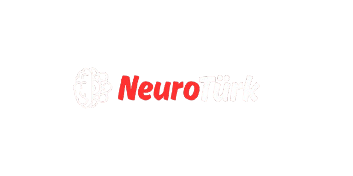
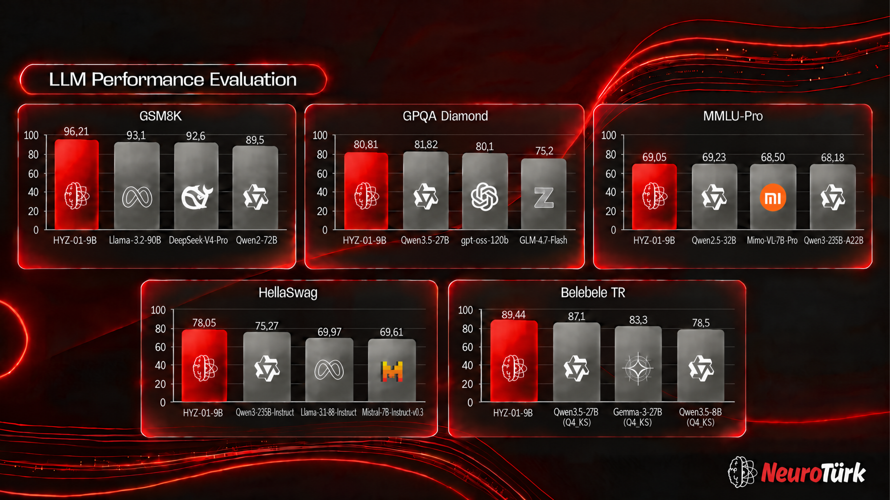

<div align="center">




<p align="center">
<a href="https://huggingface.co/NeuroTurk"></a>
<a href="https://github.com/neuroturk"></a>
<a href="https://x.com/neuroturk_ai"></a>
<a href="https://neuroturk.org"></a>
<a href="https://neuroturk.org/chat"></a>
<a href="https://neuroturk.org/dokumanlar"></a>
<a href="mailto:info@neuroturk.org"></a>
<a href="https://www.apache.org/licenses/LICENSE-2.0"></a>
</p>

</div>

---

## 1. Introduction

**HYZ-01-9B** is an open-source, thinking-capable, multimodal language model with 9 billion parameters, developed by **NeuroTürk**. It was built on top of a multilingual base model using fine-tuning and model merging techniques. It can be used for conversation, question answering, mathematics, reasoning, code generation and tool calling, primarily in Turkish and English. On several benchmarks, most notably Turkish language understanding and mathematics, it is competitive with models many times its size, and on a number of them it comes out ahead.

The model runs in thinking mode by default: responses begin with a `<think>` block before the final answer, and this behavior can be turned off with `enable_thinking=False`. In addition to text, it accepts image and video inputs and produces function calls in a structured format. It has a native context window of 262,144 tokens, which is configured to extend up to 1,048,576 tokens through dynamic scaling.

The model is released under the Apache 2.0 license.

**Quick Access:** [Live Chat](https://neuroturk.org/chat) · [Technical Docs](https://neuroturk.org/dokumanlar) · [neuroturk.org](https://neuroturk.org) · [info@neuroturk.org](mailto:info@neuroturk.org)

---

## 2. Benchmark



<div style="font-family:-apple-system,BlinkMacSystemFont,'Segoe UI',Roboto,sans-serif;width:100%;margin:0 auto;padding:16px 0">
<table style="width:100%;table-layout:fixed;border-collapse:collapse;font-size:13px">
<thead><tr>
<th style="width:22%;padding:10px 7px;text-align:left;font-weight:600;border-bottom:2px solid #E5252A;color:#E5252A"></th>
<th style="width:19.5%;padding:10px 7px;text-align:center;font-weight:700;border-bottom:2px solid #E5252A;color:#E5252A;font-size:14px;background:rgba(229, 37, 42, 0.12)">HYZ-01-9B</th>
<th colspan="3" style="width:58.5%;padding:10px 7px;text-align:center;font-weight:500;border-bottom:2px solid #E5252A;color:#E5252A;font-size:14px">Compared Models</th>
</tr></thead>
<tbody>
<tr><td colspan="5" style="padding:8px 12px;font-weight:600;color:#E5252A;border-bottom:1px solid rgba(229, 37, 42, 0.2);background:rgba(229, 37, 42, 0.1)">Mathematics</td></tr>
<tr>
<td style="padding:7px 7px;padding-left:20px;border-bottom:1px solid rgba(128, 128, 128, 0.15);">GSM8K <sub><small>(8-shot CoT)</small></sub></td>
<td style="padding:7px 7px;text-align:center;border-bottom:1px solid rgba(128, 128, 128, 0.15);font-weight:600;color:#E5252A;background:rgba(229, 37, 42, 0.06)">96.21</td>
<td style="padding:7px 7px;text-align:center;border-bottom:1px solid rgba(128, 128, 128, 0.15)"><div style="font-size:11px;opacity:0.7">Llama-3.2-90B</div><b>93.1</b></td>
<td style="padding:7px 7px;text-align:center;border-bottom:1px solid rgba(128, 128, 128, 0.15)"><div style="font-size:11px;opacity:0.7">DeepSeek-V4-Pro</div>92.6</td>
<td style="padding:7px 7px;text-align:center;border-bottom:1px solid rgba(128, 128, 128, 0.15)"><div style="font-size:11px;opacity:0.7">Qwen2-72B</div>89.5</td>
</tr>
<tr><td colspan="5" style="padding:8px 12px;font-weight:600;color:#E5252A;border-bottom:1px solid rgba(229, 37, 42, 0.2);background:rgba(229, 37, 42, 0.1)">Reasoning &amp; Knowledge</td></tr>
<tr>
<td style="padding:7px 7px;padding-left:20px;border-bottom:1px solid rgba(128, 128, 128, 0.15);">GPQA Diamond <sub><small>(0-shot CoT)</small></sub></td>
<td style="padding:7px 7px;text-align:center;border-bottom:1px solid rgba(128, 128, 128, 0.15);font-weight:600;color:#E5252A;background:rgba(229, 37, 42, 0.06)">80.81</td>
<td style="padding:7px 7px;text-align:center;border-bottom:1px solid rgba(128, 128, 128, 0.15)"><div style="font-size:11px;opacity:0.7">Qwen3.5-27B</div><b>81.82</b></td>
<td style="padding:7px 7px;text-align:center;border-bottom:1px solid rgba(128, 128, 128, 0.15)"><div style="font-size:11px;opacity:0.7">gpt-oss-120b</div>80.1</td>
<td style="padding:7px 7px;text-align:center;border-bottom:1px solid rgba(128, 128, 128, 0.15)"><div style="font-size:11px;opacity:0.7">GLM-4.7-Flash</div>75.2</td>
</tr>
<tr>
<td style="padding:7px 7px;padding-left:20px;border-bottom:1px solid rgba(128, 128, 128, 0.15);">MMLU-Pro <sub><small>(5-shot)</small></sub></td>
<td style="padding:7px 7px;text-align:center;border-bottom:1px solid rgba(128, 128, 128, 0.15);font-weight:600;color:#E5252A;background:rgba(229, 37, 42, 0.06)">69.05</td>
<td style="padding:7px 7px;text-align:center;border-bottom:1px solid rgba(128, 128, 128, 0.15)"><div style="font-size:11px;opacity:0.7">Qwen2.5-32B</div><b>69.23</b></td>
<td style="padding:7px 7px;text-align:center;border-bottom:1px solid rgba(128, 128, 128, 0.15)"><div style="font-size:11px;opacity:0.7">Mimo-VL-7B-Pro</div>68.50</td>
<td style="padding:7px 7px;text-align:center;border-bottom:1px solid rgba(128, 128, 128, 0.15)"><div style="font-size:11px;opacity:0.7">Qwen3-235B-A22B</div>68.18</td>
</tr>
<tr><td colspan="5" style="padding:8px 12px;font-weight:600;color:#E5252A;border-bottom:1px solid rgba(229, 37, 42, 0.2);background:rgba(229, 37, 42, 0.1)">Language Understanding</td></tr>
<tr>
<td style="padding:7px 7px;padding-left:20px;border-bottom:1px solid rgba(128, 128, 128, 0.15);">HellaSwag <sub><small>(10-shot)</small></sub></td>
<td style="padding:7px 7px;text-align:center;border-bottom:1px solid rgba(128, 128, 128, 0.15);font-weight:600;color:#E5252A;background:rgba(229, 37, 42, 0.06)">78.05</td>
<td style="padding:7px 7px;text-align:center;border-bottom:1px solid rgba(128, 128, 128, 0.15)"><div style="font-size:11px;opacity:0.7">Qwen3-235B-Instruct</div><b>75.27</b></td>
<td style="padding:7px 7px;text-align:center;border-bottom:1px solid rgba(128, 128, 128, 0.15)"><div style="font-size:11px;opacity:0.7">Llama-3.1-8B-Instruct</div>69.97</td>
<td style="padding:7px 7px;text-align:center;border-bottom:1px solid rgba(128, 128, 128, 0.15)"><div style="font-size:11px;opacity:0.7">Mistral-7B-Instruct-v0.3</div>69.61</td>
</tr>
<tr>
<td style="padding:7px 7px;padding-left:20px;border-bottom:1px solid rgba(128, 128, 128, 0.15);">Belebele TR <sub><small>(0-shot)</small></sub></td>
<td style="padding:7px 7px;text-align:center;border-bottom:1px solid rgba(128, 128, 128, 0.15);font-weight:600;color:#E5252A;background:rgba(229, 37, 42, 0.06)">89.44</td>
<td style="padding:7px 7px;text-align:center;border-bottom:1px solid rgba(128, 128, 128, 0.15)"><div style="font-size:11px;opacity:0.7">Qwen3.5-27B (Q4_KS)</div><b>87.1</b></td>
<td style="padding:7px 7px;text-align:center;border-bottom:1px solid rgba(128, 128, 128, 0.15)"><div style="font-size:11px;opacity:0.7">Gemma-3-27B (Q4_KS)</div>83.3</td>
<td style="padding:7px 7px;text-align:center;border-bottom:1px solid rgba(128, 128, 128, 0.15)"><div style="font-size:11px;opacity:0.7">Qwen3.5-8B (Q4_KS)</div>78.5</td>
</tr>
</tbody>
</table>

<p style="margin-top:12px;font-size:10px;opacity:0.7">
* All evaluations were run with lm-evaluation-harness (vLLM backend).<br/>
* HYZ-01-9B was evaluated with full-precision weights (not quantized) on every test, including Belebele TR. The models marked <code>Q4_KS</code> in the Belebele TR comparison are 4-bit quantized versions.<br/>
* Scores of the compared models: [SOURCE TO BE SPECIFIED].<br/>
* Evaluations are text-only; no separate measurement has been made for image and video capabilities.
</p>
</div>

---

## 3. Usage

<div style="border-left:4px solid #E5252A;background:rgba(229,37,42,0.1);border-radius:6px;padding:12px 16px;font-family:-apple-system,BlinkMacSystemFont,'Segoe UI',Roboto,sans-serif;font-size:14px;line-height:1.6;margin-bottom:24px">
<div style="font-weight:700;color:#E5252A;margin-bottom:6px">⚠️ CONTEXT LENGTH &amp; vLLM COMPATIBILITY</div>
<p style="margin:0 0 10px">This model is architecturally designed to support up to <b>1,048,576 (1M) tokens</b> of context length. However, due to a known mRoPE (multimodal Rotary Position Embedding) issue in current vLLM versions (v0.32.0 and below), the engine may crash when the 1M context is activated.</p>
<p style="margin:0 0 10px">Therefore, the default <code style="background:rgba(229,37,42,0.15);padding:1px 5px;border-radius:4px">config.json</code> in the Hugging Face repo is optimized and set for the most stable <b>262,144 (262K) context length</b>. You can run the model smoothly with vLLM or Transformers without any modifications.</p>
<p style="margin:0 0 6px"><b>🚀 To Enable 1M (1,048,576 Token) Context:</b></p>
<p style="margin:0 0 10px">If you want to push the 1M context limits and encounter the following error in vLLM: <code style="background:rgba(229,37,42,0.15);padding:1px 5px;border-radius:4px">RuntimeError: rotary_embedding, query, key and positions must have the same batch_size and seq_len</code>, please follow these steps:</p>
<ol style="margin:0 0 10px;padding-left:20px">
<li>Download the <code style="background:rgba(229,37,42,0.15);padding:1px 5px;border-radius:4px">config_1m.json</code> file from the repo and rename it to <code style="background:rgba(229,37,42,0.15);padding:1px 5px;border-radius:4px">config.json</code>.</li>
<li>Add the <code style="background:rgba(229,37,42,0.15);padding:1px 5px;border-radius:4px">--max-num-batched-tokens 8192</code> parameter when starting vLLM to prevent OOM (Out of Memory).</li>
</ol>
<p style="margin:0;font-size:12px;opacity:0.8"><i>(Note: 1M context will require high memory consumption depending on your VRAM capacity. Once resolved in future vLLM updates, the default config will be updated back to 1M.)</i></p>
</div>

<div style="border-left:4px solid #E5252A;background:rgba(229,37,42,0.1);border-radius:6px;padding:12px 16px;font-family:-apple-system,BlinkMacSystemFont,'Segoe UI',Roboto,sans-serif;font-size:14px;line-height:1.6">
<div style="font-weight:700;color:#E5252A;margin-bottom:6px">📝 NOTE</div>
<p style="margin:0 0 10px"><b>HYZ-01-9B</b> is a <b>reasoning model</b>: by default the assistant response begins with a <code style="background:rgba(229,37,42,0.15);padding:1px 5px;border-radius:4px">&lt;think&gt; … &lt;/think&gt;</code> block before the final answer. Because the chat template adds the opening <code style="background:rgba(229,37,42,0.15);padding:1px 5px;border-radius:4px">&lt;think&gt;</code> tag to the prompt itself, only <code style="background:rgba(229,37,42,0.15);padding:1px 5px;border-radius:4px">&lt;/think&gt;</code> appears in the generated text. The serving commands below enable a reasoning parser that returns the thinking trace in a separate field, and a tool-call parser that exposes <code style="background:rgba(229,37,42,0.15);padding:1px 5px;border-radius:4px">&lt;tool_call&gt;</code> blocks as OpenAI-compatible <code style="background:rgba(229,37,42,0.15);padding:1px 5px;border-radius:4px">tool_calls</code>.</p>
<p style="margin:0 0 6px">Required runtime versions:</p>
<ul style="margin:0 0 10px;padding-left:20px">
<li><b>Transformers</b> ≥ 5.3.0</li>
<li><b>vLLM</b> ≥ 0.17.1</li>
<li><b>SGLang</b> ≥ 0.5.9</li>
</ul>
<p style="margin:0 0 6px">Recommended sampling parameters:</p>
<ul style="margin:0;padding-left:20px">
<li><b>Thinking on (default):</b> <code style="background:rgba(229,37,42,0.15);padding:1px 5px;border-radius:4px">temperature=1.0</code>, <code style="background:rgba(229,37,42,0.15);padding:1px 5px;border-radius:4px">top_p=0.95</code>, <code style="background:rgba(229,37,42,0.15);padding:1px 5px;border-radius:4px">top_k=20</code>, <code style="background:rgba(229,37,42,0.15);padding:1px 5px;border-radius:4px">min_p=0.0</code>, <code style="background:rgba(229,37,42,0.15);padding:1px 5px;border-radius:4px">presence_penalty=1.5</code>, <code style="background:rgba(229,37,42,0.15);padding:1px 5px;border-radius:4px">repetition_penalty=1.0</code></li>
<li><b>Thinking off</b> (<code style="background:rgba(229,37,42,0.15);padding:1px 5px;border-radius:4px">enable_thinking=False</code>): <code style="background:rgba(229,37,42,0.15);padding:1px 5px;border-radius:4px">temperature=0.7</code>, <code style="background:rgba(229,37,42,0.15);padding:1px 5px;border-radius:4px">top_p=0.8</code>, <code style="background:rgba(229,37,42,0.15);padding:1px 5px;border-radius:4px">top_k=20</code>, <code style="background:rgba(229,37,42,0.15);padding:1px 5px;border-radius:4px">min_p=0.0</code>, <code style="background:rgba(229,37,42,0.15);padding:1px 5px;border-radius:4px">presence_penalty=1.5</code>, <code style="background:rgba(229,37,42,0.15);padding:1px 5px;border-radius:4px">repetition_penalty=1.0</code></li>
</ul>
</div>

### Serving

**vLLM:**

```bash
vllm serve neuroturk/HYZ-01-9B \
  --served-model-name HYZ-01-9B \
  --host 0.0.0.0 \
  --port 8000 \
  --max-model-len 262144 \
  --enable-auto-tool-choice \
  --tool-call-parser qwen3_coder \
  --reasoning-parser qwen3 \
  --trust-remote-code
```

To run in text-only mode, you can add `--language-model-only` to the command.

**SGLang:**

```bash
python -m sglang.launch_server \
  --model-path neuroturk/HYZ-01-9B \
  --served-model-name HYZ-01-9B \
  --host 0.0.0.0 \
  --port 8000 \
  --context-length 262144 \
  --tool-call-parser qwen3_coder \
  --reasoning-parser qwen3
```

### Chat Completions API

Once the server is up, any OpenAI-compatible client can be used.

```python
from openai import OpenAI

client = OpenAI(base_url="http://localhost:8000/v1", api_key="EMPTY")

response = client.chat.completions.create(
    model="HYZ-01-9B",
    messages=[{"role": "user", "content": "What is the capital of Türkiye?"}],
    temperature=1.0,
    top_p=0.95,
    extra_body={"top_k": 20, "presence_penalty": 1.5},
    # To turn thinking off, add this to extra_body:
    # "chat_template_kwargs": {"enable_thinking": False}
)

message = response.choices[0].message
# Depending on the vLLM version, the thinking trace is returned in "reasoning_content" or "reasoning".
reasoning = getattr(message, "reasoning_content", None) or getattr(message, "reasoning", None)
print("reasoning:", reasoning)
print("answer:", message.content)
```

**Tool calling:**

```python
tools = [
    {
        "type": "function",
        "function": {
            "name": "get_weather",
            "description": "Get the current weather for a city",
            "parameters": {
                "type": "object",
                "properties": {"city": {"type": "string"}},
                "required": ["city"],
            },
        },
    }
]

response = client.chat.completions.create(
    model="HYZ-01-9B",
    messages=[{"role": "user", "content": "What is the weather like in Ankara?"}],
    tools=tools,
    tool_choice="auto",
    temperature=0.6,
)

tool_call = response.choices[0].message.tool_calls[0]
print(tool_call.function.name, tool_call.function.arguments)
# -> get_weather {"city": "Ankara"}
```

**Image input:**

```python
response = client.chat.completions.create(
    model="HYZ-01-9B",
    messages=[{
        "role": "user",
        "content": [
            {"type": "image_url", "image_url": {"url": "https://example.com/image.jpg"}},
            {"type": "text", "text": "Describe this image in one sentence."},
        ],
    }],
)
print(response.choices[0].message.content)
```

### Transformers

```python
import torch
from transformers import AutoTokenizer, AutoModelForCausalLM

model_name = "neuroturk/HYZ-01-9B"

tokenizer = AutoTokenizer.from_pretrained(model_name, trust_remote_code=True)
model = AutoModelForCausalLM.from_pretrained(
    model_name, torch_dtype=torch.bfloat16, device_map="auto", trust_remote_code=True
)

messages = [{"role": "user", "content": "What is artificial intelligence? Explain briefly."}]

inputs = tokenizer.apply_chat_template(
    messages,
    add_generation_prompt=True,
    return_tensors="pt",
    return_dict=True,
    # enable_thinking=False,  # to turn thinking off
).to(model.device)

outputs = model.generate(
    **inputs, max_new_tokens=4096, do_sample=True, temperature=1.0, top_p=0.95, top_k=20
)

text = tokenizer.decode(
    outputs[0][inputs["input_ids"].shape[-1]:], skip_special_tokens=False
).replace("<|im_end|>", "").strip()

# The prompt ends with "<think>", so only "</think>" appears in the output.
if "</think>" in text:
    reasoning, answer = text.split("</think>", 1)
else:
    reasoning, answer = "", text

print("reasoning:", reasoning.strip())
print("answer:", answer.strip())
```

## 4. Limitations

- Although the model follows instructions well, it may occasionally produce incorrect, inconsistent or fabricated outputs.
- Performance is best in **Turkish and English**; problems may occur in languages other than these.
- With thinking mode on, responses can contain long reasoning traces; for simple tasks it is more efficient to turn it off.
- Context lengths beyond 262,144 tokens are supported at the configuration level; quality and memory usage should be verified separately.
- For critical applications such as law, medicine and finance, human verification of outputs is recommended.

---

## 5. Citation


```bibtex
@misc{neuroturk2026hyz01,
    title        = {HYZ-01-9B, A Fast, Powerful, and Multilingual Model},
    author       = {NeuroTürk},
    year         = {2026},
    url          = {https://neuroturk.org},
    
}
```

<div align="center">
<sub>NeuroTürk · HYZ-01 · 2026</sub>
</div>
